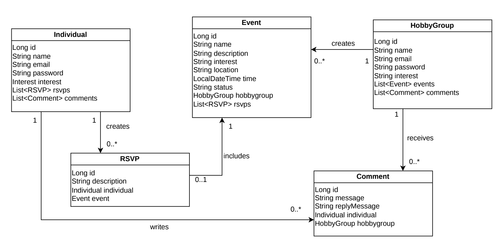

# HobbyCircles backend API

# UML Class Diagram



# API Overview

**Version:** 1.0
**Last Updated:** October 23, 2026

**Base URL:**

- local: http://localhost:8080/api
- production: https://f26-team5.onrender.com/api/

JSON request bodies are validated. The endpoint tables list applicable error
codes: `400 Bad Request` for invalid input, `404 Not Found` for missing
resources, and `409 Conflict` for duplicate records or invalid state
transitions.

## Profile and discovery

| Method | Path                            | Purpose                                                    | Response code | Error codes | User story                                                              |
| ------ | ------------------------------- | ---------------------------------------------------------- | ------------- | ----------- | ----------------------------------------------------------------------- |
| `POST` | `/api/hobbygroups`              | Register a group profile   |`201 Created` | `400, 409`  |[US-2.1](../docs/SRS-HobbyCircles.md#L21)
| `PUT` | `/api/hobbygroups/{hobbyGroupId}`| Update a group profile     |`200 OK` | `400, 404, 409`  |[US-2.1](../docs/SRS-HobbyCircles.md#L21)
| `GET` | `/api/hobbygroups/{hobbyGroupId}`| View a group profile       |`200 OK` | `404`  |[US-2.1](../docs/SRS-HobbyCircles.md#L21)
| `GET` | `/api/hobbygroups`               | Browse groups              | `200 OK`| `400`  |[US-1.?](../docs/SRS-HobbyCircles.md#L)
| `POST` | `/api/individuals`              | Register an individual profile | `200 Created`| `400, 409`  |[US-1](../docs/SRS-HobbyCircles.md#L44)
| `PUT` | `/api/individuals/{individualId}`| Update a group profile     |`200 OK` | `400, 404, 409`  |[US-2](../docs/SRS-HobbyCircles.md#L55)
| `GET` | `/api/individuals/{individualId}`| View an individual profile       |`200 OK` | `404`  |[US-2](../docs/SRS-HobbyCircles.md#L55)

### Example Hobby Group Request

```http
POST /api/hobbygroups
Content-Type: application/json

 {
    "name": "Greensboro Trail Runners",
    "email": "trailrunners@example.com",
    "password": "RunFast2026",
    "interest": "OUTDOORS"
  }
```
### Example Hobby Group Update Request

```http
PUT /api/hobbygroups/{hobbyGroupId}
Content-Type: application/json

 {
    "name": "Greensboro Trail & Road Runners",
    "email": "runners@example.com",
    "interest": "SPORTS"
  }
```
### Example Individual Request

```http
POST /api/individuals
Content-Type: application/json

 {
    "name": "John Doe",
    "email": "jDoe@example.com",
    "password": "iluvmovies123",
    "interest": "FILM"
  }
```
### Example Individual Update Request

```http
PUT /api/individuals/{individualId}
Content-Type: application/json

 {
    "name": "John Stewart",
    "email": "jStewart@example.com",
    "interest": "FIlM"
  }
```

## Events

| Method | Path                            | Purpose                    | Response code | Error codes | User story                                                              |
| ------ | ------------------------------- | ---------------------------------------------------------- | ------------- | ----------- | ----------------------------------------------------------------------- |
| `POST` | `/api/hobbygroups/{hobbyGroupId}/events`|Create an event     | `201 Created` | `400, 404`  | [US-2.2](../docs/SRS-HobbyCircles.md#L22)
| `PUT` | `/api/hobbygroups/{hobbyGroupId}/events/{eventId}`|Update an event| `200 OK` | `400, 404`  | [US-2.2](../docs/SRS-HobbyCircles.md#L22)  
| `GET` | `/api/hobbygroups/{hobbyGroupId}/events` | Browse events          | `200 OK`| `404`  |[US-1.2](../docs/SRS-HobbyCircles.md#L15)
| `GET` | `/api/hobbygroups/{hobbyGroupId}/events` | View an event          | `200 OK`| `404`  |[US-1.2](../docs/SRS-HobbyCircles.md#L15)     

Event time uses ISO-8601 local date-time values, for example
`"2030-05-10T14:30:00"`.

### Example Event Request

```http
POST /api/hobbygroups/{hobbyGroupId}/events
Content-Type: application/json

{
    "name": "Saturday Morning Group Run",
    "description": "Easy 5-mile run along the greenway. All paces welcome.",
    "interest": "OUTDOORS",
    "location": "Country Park, Greensboro",
    "time": "2026-11-07T08:30:00",
    "status": "PUBLISHED"
  }
```

### Example Event Update Request

```http
PUT /api/hobbygroups/{hobbyGroupId}/events/{eventId}
Content-Type: application/json

{
    "name": "Saturday Morning Group Run (Updated)",
    "description": "Moved to 9 AM. Now a 6-mile route.",
    "interest": "OUTDOORS",
    "location": "Country Park Pavilion 2, Greensboro",
    "time": "2026-11-07T09:00:00",
    "status": "PUBLISHED"
  }
```

## RSVPs and comments

| Method  | Path                                                          | Purpose                                               | Response code | Error codes | User story                                                              |
| ------- | ------------------------------------------------------------- | ----------------------------------------------------- | ------------- | ----------- | ----------------------------------------------------------------------- |
| `GET` | `/api/hobbygroups/{hobbyGroupId}/events/{eventId}/rsvps`| View RSVPs for an event| `200 OK`| `404`  |[US-2.4](../docs/SRS-HobbyCircles.md#L24)                                  |
| `GET` | `/api/hobbygroups//{hobbyGroupId}/comments`| View comments| `200 OK`| `404`  |[US-2.3](../docs/SRS-HobbyCircles.md#L23) 
| `POST` | `/{hobbyGroupId}/comments/{commentId}/replies`| Reply to comments| `201 Created`| `400, 404`  |[US-2.3](../docs/SRS-HobbyCircles.md#L23) 
| `GET` | `/api/individuals/{individualId}/rsvps`| View RSVP's created       |`200 OK` | `404`  |[US-6](../docs/SRS-HobbyCircles.md#L95)
| `POST` | `/api/individuals/{individualId}/rsvps` | RSVP to an event | `200 Created`| `400, 409`  |[US-4](../docs/SRS-HobbyCircles.md#L75)
| `GET` | `/api/individuals/{individualId}/comment`| View comments an individual has created   |`200 OK` | `404`  |[US-5](../docs/SRS-HobbyCircles.md#L85)
| `POST` | `/api/individuals/{individualId}/comments` | Create a comment | `200 Created`| `400, 409`  |[US-5](../docs/SRS-HobbyCircles.md#L85)

### Example Comment Reply Request

```http
POST /{hobbyGroupId}/comments/{commentId}/replies
Content-Type: application/json

{
    "replyMessage": "Great question! Yes, beginners are welcome — we have a walk/run group too."
  }
```
### Example RSVP Request

```http
POST /api/individuals/{individualId}/rsvps
Content-Type: application/json

{
    "eventId": 1
}
```
### Example Comment Request

```http
POST /api/individuals/{individualId}/comments
Content-Type: application/json

{
    "hobbyGroupId": 1,
    "message":"Is this group open to beginners?"
}
```
